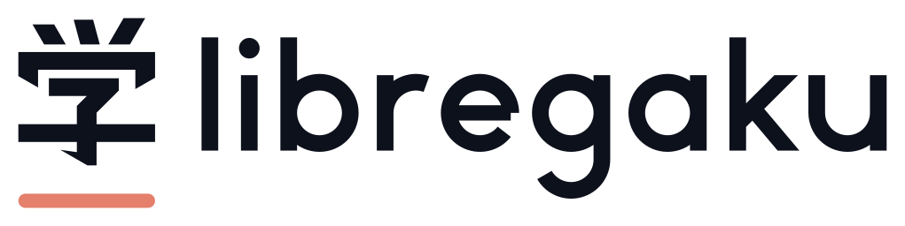

<p align="center">
  <picture>
    <source media="(prefers-color-scheme: dark)" srcset="brand/libregaku-logo-horizontal-color-on-dark.svg">
    
  </picture>
</p>

<p align="center">
  <a href="https://github.com/donth77/libregaku/actions/workflows/ci.yml"></a>
  <a href="https://github.com/donth77/libregaku/actions/workflows/canary.yml"></a>
  
  
  
</p>

Clickable subtitles for YouTube, Netflix, Disney+, Prime Video, HBO Max, Apple TV and Viki,
with a dictionary and a transcript. Make Anki cards from any word or sentence. Free and open
source.

---

## What it does

Watch something in the language you're learning. Unknown words are highlighted. Click
one, read the definition, make a card. Over time the highlighting fades as the words
become yours.

[`SUPPORTED-SITES.md`](SUPPORTED-SITES.md) lists the sites it works on, and what
differs between them.


## Requirements

- Chrome 116 or later, or another Chromium browser such as Brave or Edge.
- [Anki](https://apps.ankiweb.net/) with the
  [AnkiConnect](https://ankiweb.net/shared/info/2055492159) add-on, to make cards and
  to know which words you've learned. Without Anki, subtitles, lookups and the
  transcript still work.

### Is Anki free?

Almost all of it is free software. The two parts that aren't are optional.

| Part | Licence | Free software? |
|---|---|---|
| Anki desktop (Windows, macOS, Linux) | AGPL-3.0 | Yes |
| AnkiDroid (Android) | GPL-3.0 | Yes |
| AnkiConnect add-on | GPL | Yes |
| Anki's own sync server (comes with Anki 2.1.57+) | AGPL-3.0 | Yes |
| AnkiWeb sync | Proprietary | No. The sync server above replaces it. |
| AnkiMobile (iPhone, iPad) | Proprietary, $24.99 once | No. Optional. |

## Install from source

```sh
git clone https://github.com/donth77/libregaku
cd libregaku
pnpm install
pnpm build
```

Then open `chrome://extensions`, turn on **Developer mode**, click **Load unpacked**,
and pick the `dist/` folder.

After each rebuild, click the extension's reload button, then reload the video tab.

```sh
pnpm dev        # rebuild on every change
pnpm typecheck
```

## Languages

| Languages | Support |
|---|---|
| Japanese | Full, with furigana |
| Chinese (Mandarin) | Full, with pinyin |
| Cantonese | Full, with Jyutping |
| Korean, Spanish, French, German, Italian, Portuguese, Thai, Hindi, Arabic, Turkish, English | Full |

Definitions come in your own language where a dictionary has them, and in English otherwise.
[`LANGUAGE-PAIRS.md`](LANGUAGE-PAIRS.md) lists each pair and the dictionaries behind it.

## Help

Something not working, or a question? [Open an issue](https://github.com/donth77/libregaku/issues).

## Privacy

No account, no server, and nothing sent to the developer. [`PRIVACY.md`](PRIVACY.md) lists the few
times a word or a download request leaves your computer, and to whom.
[`TERMS.md`](TERMS.md) has the terms of use.

## Licence

The code is MIT ([`LICENSE`](LICENSE)). The dictionaries, recordings and other data it uses
keep their own licences: [`SOURCES.md`](SOURCES.md) lists each, with what it gives.
